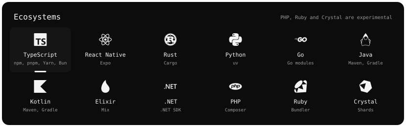

<a href="https://better-fullstack.dev"></a>

<p align="center">
Scaffold fullstack projects from a catalog of Stack Parts.<br>
Use the CLI, the Stack Builder in your browser, or an MCP server for AI agents.
</p>

<p align="center"><a href="https://better-fullstack.dev">Website</a> &nbsp;·&nbsp; <a href="https://better-fullstack.dev/docs">Docs</a> &nbsp;·&nbsp; <a href="https://better-fullstack.dev/new">Stack Builder</a> &nbsp;·&nbsp; <a href="https://better-fullstack.dev/docs/ai/mcp">MCP</a> &nbsp;·&nbsp; <a href="https://better-fullstack.dev/changelog">Changelog</a> &nbsp;·&nbsp; <a href="https://www.npmjs.com/package/create-better-fullstack">npm</a></p>

<p align="center">
<a href="https://www.npmjs.com/package/create-better-fullstack"></a>
&nbsp;
<a href="https://www.npmjs.com/package/create-better-fullstack"></a>
</p>

## Quick start

Run one command to scaffold a new project:

```bash
bun create better-fullstack@latest
```

```bash
npm create better-fullstack@latest
```

```bash
pnpm create better-fullstack@latest
```

```bash
yarn create better-fullstack@latest
```

After creating a project, use the CLI's `add`, `update`, `check`, and `gen` commands to maintain it. See the [lifecycle guide](https://better-fullstack.dev/docs/getting-started/lifecycle).

The Stack Builder runs in your browser and hands you the command to copy, or a ZIP download: **[Open the Stack Builder →](https://better-fullstack.dev/new)**

## What it covers

Multi-Ecosystem mode composes frontend, backend, database, and mobile parts from different languages into one project, like a TypeScript frontend with a Go backend.

<a href="https://better-fullstack.dev/docs/ecosystems"></a>

<p><a href="https://better-fullstack.dev/new"></a><a href="https://better-fullstack.dev/docs/builder"></a><a href="https://better-fullstack.dev/docs/ai/mcp"></a><a href="https://better-fullstack.dev/docs/choosing-a-stack"></a><a href="https://better-fullstack.dev/docs/getting-started/lifecycle"></a><a href="https://better-fullstack.dev/docs/verification"></a></p>

## AI agents

Install the MCP server and both Better Fullstack skills for every coding agent on your machine:

```bash
npx create-better-fullstack@latest install
```

Or add the MCP server to one agent:

```bash
claude mcp add --scope user better-fullstack -- npx -y create-better-fullstack@latest mcp
```

```bash
codex mcp add better-fullstack -- npx -y create-better-fullstack@latest mcp
```

Agents can also read [`llms.txt`](llms.txt). The [MCP docs](https://better-fullstack.dev/docs/ai/mcp) cover other clients.

## Contributors

Everyone with a pull request merged into Better Fullstack.

<!-- contributors:start -->
<p><a href="https://github.com/Alisha-21-cloud"></a><a href="https://github.com/taltas"></a><a href="https://github.com/dinwwwh"></a><a href="https://github.com/Kavin-Bakyaraj"></a><a href="https://github.com/Divith123"></a></p>
<!-- contributors:end -->

Want to join them? Read the [Contributing Guide](.github/CONTRIBUTING.md).

## Community

[](https://x.com/IbrahimElkamali)
&nbsp;
[](https://t.me/TheCr1nge)
&nbsp;
[](https://github.com/Marve10s)

Found a bug? Open a [GitHub issue](https://github.com/Marve10s/Better-Fullstack/issues).

If Better Fullstack saves you time, consider sponsoring:

<a href="https://github.com/sponsors/Marve10s"></a>
&nbsp;&nbsp;
<a href="https://www.patreon.com/c/marve10s"></a>

<!--
Star History is hidden while GitHub restricts stargazer data to repo admins and
collaborators, which makes the chart render an error placard instead of a graph:
https://star-history.com/blog/github-stargazer-api-restriction
Restore this block once the API is public again.

## Star history

<div align="center">
  <a href="https://star-history.com/#Marve10s/Better-Fullstack&Date">
    <picture>
      <source media="(prefers-color-scheme: dark)" srcset="https://api.star-history.com/svg?repos=Marve10s/Better-Fullstack&type=Date&theme=dark" />
      <source media="(prefers-color-scheme: light)" srcset="https://api.star-history.com/svg?repos=Marve10s/Better-Fullstack&type=Date" />
      
    </picture>
  </a>
</div>
-->

## License

MIT. Better Fullstack was originally forked from [Better T Stack](https://github.com/AmanVarshney01/create-better-t-stack) by [Aman Varshney](https://github.com/AmanVarshney01) and is now independently maintained with its own direction.
